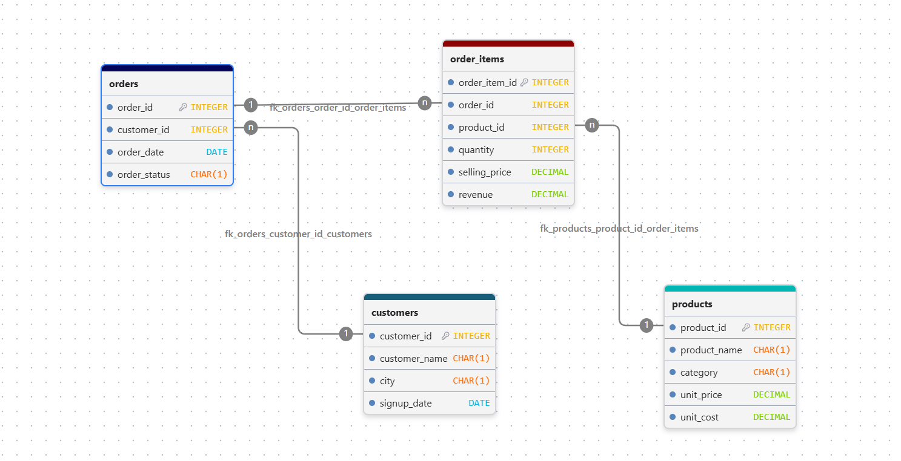

# E-Commerce Sales & Customer Analytics

A data analytics project focused on analysing e-commerce sales performance, product trends, and customer purchasing behaviour using SQL and Python.

## 📌 Project Overview

The **E-Commerce Sales & Customer Analytics** project explores sales data to extract meaningful business insights. It uses a relational database to organise customer, product, order, and order-item information, followed by data analysis in Python.

The main objective is to understand sales performance, identify top-selling products, evaluate product profitability, and analyse customer purchasing patterns using data-driven approaches.

## 🎯 Project Objectives

- Analyse overall sales revenue and product performance.
- Identify top-selling products and product categories.
- Calculate estimated profit and compare product profitability.
- Understand customer purchasing behaviour and repeat purchases.
- Analyse monthly sales trends.
- Explore order statuses and customer spending patterns.
- Practise SQL querying, data manipulation, and analytical problem-solving.

## 🛠️ Technologies Used

- **PostgreSQL / SQL** — Database creation, data management, joins, filtering, aggregations, and analytical queries.
- **Python** — Data analysis and query result processing.
- **Jupyter Notebook** — Interactive analysis and documentation.
- **Pandas** — Data manipulation and analysis.
- **Rich** — Formatting SQL query results into readable tables in the terminal.

## 📂 Project Structure

```text
E-Commerce_Analysis/
│
├── README.md
├── Schema.sql
├── ecommerce.ipynb
└── Table_Formatter.py
└── requirement.txt
```

### File Description

| File | Description |
|---|---|
| `README.md` | Project overview, objectives, and documentation. |
| `Schema.sql` | Creates the database schema, defines tables, and inserts sample data. |
| `ecommerce.ipynb` | Main analysis notebook containing SQL-based analysis and Python workflows. |
| `Table_Formatter.py` | Uses the Rich library to display tabular query results in a clean, readable format. |
| `requirement.txt` | Name of the modules to install for run the code.

## 📊 Database Architecture Image

Below is the entity-relationship layout and table structure mapping out the database schema, primary/foreign keys, and column structures:



---

## 🗄️ Database Schema

The project uses four relational tables connected through primary and foreign keys.

### 1. Customers

Stores customer information, including customer ID, name, city, and signup date.

### 2. Products

Contains product details such as product name, category, unit selling price, and unit cost.

### 3. Orders

Stores order information, including customer ID, order date, and order status.

### 4. Order Items

Contains individual product lines for each order, including product ID, order ID, quantity, and selling price.

These relationships allow information to be combined across tables to answer business questions using SQL joins.

## 📊 Key Analysis Areas

### Sales Performance
- Total sales revenue from completed orders.
- Monthly revenue trends.
- Revenue contribution by product category.
- Average order value (AOV).

### Product Analysis
- Best-selling products by quantity.
- Product revenue comparison.
- Estimated profit by product and category.
- Products that have never been ordered.

### Customer Analysis
- Top customers by total spending.
- Repeat customer identification.
- Customer order frequency.
- Customers who have never placed an order.
- Customers whose spending exceeds the average.

### Order Analysis
- Completed, pending, and cancelled order distribution.
- Order counts by status.
- Sales analysis with cancelled orders excluded from revenue calculations.

## 📈 Business Rules

- Only completed orders are included when calculating realised sales revenue.
- Pending and cancelled orders are excluded from completed-sales calculations.
- Revenue is calculated as selling price multiplied by quantity.
- Estimated profit is calculated as the difference between the selling price and unit cost, multiplied by quantity.
- Average order value is calculated as completed-order revenue divided by the number of completed orders.

**Note:** Profit is an estimate based on product cost and selling price. It does not account for additional expenses such as shipping, marketing, taxes, or operating costs.

## ⚙️ Installation and Setup

### Prerequisites

Make sure you have installed:

- Python 3.x
- PostgreSQL (if using PostgreSQL) / MySQL
- Jupyter Notebook
- Required Python libraries

### 1. Clone the Repository

```bash
git clone <your-repository-url>
cd E-Commerce_Analysis
```

### 2. Set Up the Database

Open `Schema.sql` in your SQL editor and execute the script to create the tables and insert the sample data.

If the script does not create the database itself, create the database first and connect to it before running the remaining SQL statements.

### 3. Install Python Dependencies

```bash
pip install -r requirement.txt
```

Install the appropriate database connector if your notebook connects directly to PostgreSQL or SQLite.

### 4. Run the Analysis

Start Jupyter Notebook:

```bash
jupyter notebook
```

Open `ecommerce.ipynb` and execute the cells in order.

## 💡 Key Learnings

Through this project, I practised:

- Designing a relational database with multiple related tables.
- Writing SQL queries for business analysis.
- Using joins, aggregate functions, grouping, filtering, and sorting.
- Calculating revenue, average order value, and estimated profit.
- Analysing customer behaviour and product performance.
- Integrating SQL analysis with Python workflows.
- Improving the readability of terminal output using the Rich library.

## 🚀 Future Improvements

- Build an interactive dashboard using Power BI or Streamlit.
- Add more advanced SQL queries using CTEs and window functions.
- Introduce larger datasets for deeper analysis.
- Automate the analysis and reporting process.
- Add visualisations for monthly sales and customer trends.

## 👨‍💻 Author

**Rakesh Kumar Dey**

Aspiring Data Analyst | SQL | Python | Excel | Power BI

---

*This project was developed as a practical learning project to strengthen SQL and Python analytics skills through an e-commerce business scenario.*
